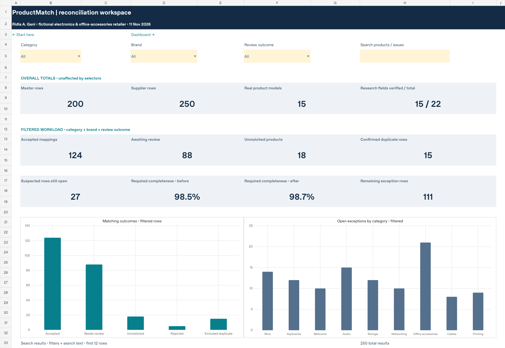

# ProductMatch

**Product Reconciliation & Data Quality Workspace** · Ridla A. Gani

Supplier feeds and internal catalogs rarely describe the same product in the same way. Names vary, identifiers are missing, and similar names can hide different colors, capacities, hardware versions, or pack sizes. I built ProductMatch as a macro-free Excel workspace for cleaning those records, reviewing proposed matches, and exporting accepted mappings while keeping unresolved exceptions visible.

This is a personal demonstration project using synthetic trading data: 200 master rows and 250 supplier rows. Fifteen identifiable real product models are included for field-level research through official sources. Prices, offers, supplier SKUs, and reviewer decisions are simulated; fictional products use `DEMO-` model names.

**[Download ProductMatch.xlsx](ProductMatch.xlsx?raw=true)** · [Case study](docs/case_study.md) · [Case study PDF](docs/ProductMatch_case_study.pdf) · [Two-minute walkthrough](docs/demo_script.md)



*Rendered preview of the delivered workbook, rather than a capture of the Excel application.*

## How it works

1. **Clean:** preserve the raw feeds, normalize whitespace and aliases, check required fields, and flag exact or suspected duplicates. Corrections live in a separate keyed table.
2. **Match:** prioritize nonblank manufacturer part numbers, then brand/model/variant and normalized attributes. Python supplies a separate snapshot of fuzzy name candidates.
3. **Review:** accept a compatible match, select another master, reject a suggestion, or leave it pending. The approved master ID is stored separately from suggestions, so a refresh cannot silently change an approval.
4. **Research:** record the exact model, source, evidence, access date, and approval for each field. Only eligible, uniquely approved `Specification` fields apply automatically in this version.
5. **Export:** native formulas build the accepted catalog and exception queue. Python can export the workbook's saved results to CSV.

Excel handles cleaning, matching rules, review outcomes, dashboard calculations, and final output through tables, text formulas, `INDEX/MATCH`, `VLOOKUP`, `COUNTIFS`, and `SUMPRODUCT`. Validation, conditional formatting, hyperlinks, and two linked charts support review. Python uses the standard library for candidate scoring, data generation, CSV export, and verification; JavaScript with `@oai/artifact-tool` supplies the original workbook builder.

## Demonstration results

These are the delivered baseline, checked against saved workbook results and constructed evaluation labels. They describe this demonstration, not production accuracy or business impact.

| Measure | Result and meaning |
| --- | --- |
| Accepted mappings | **124** nonduplicate supplier rows exported |
| Excluded supplier duplicates | **15** retransmissions; raw rows remain intact |
| Remaining exceptions | **111** = 88 awaiting review + 18 unmatched + 5 rejected |
| Suggested-mapping precision | **94.0%** = 204 correct suggestions / 217 suggestions |
| Positive suggestion recall | **94.9%** = 204 correct suggestions / 215 known positive cases |
| Required-field completeness | **98.52% → 98.72%**, using the same 2,500 required cells; presence, not validity |
| Research evidence | **15 verified Specification fields** across 15 real models; 7 other fields unresolved |

The partition reconciles: **124 + 111 + 15 = 250**. Evaluation excludes the 15 labeled duplicate rows. Seeded accepted decisions agree with the constructed counterparts (124/124); that checks the demonstrated review state. [Metric definitions and context](docs/case_study.md).

## Open, refresh, and export

Open the downloaded workbook in **Excel 365 desktop**, enable **Automatic** calculation, and begin at **START HERE**. Normal workbook review needs no Python, macros, add-ins, or internet connection. Use a copy when practicing decisions.

For fuzzy refresh, save and close the workbook first. From the repository root, with **Python 3.10+**:

```bash
python scripts/refresh_productmatch.py --workbook ProductMatch.xlsx --in-place
```

This creates `ProductMatch.xlsx.bak` and preserves the manual input sheets. Reopen, calculate, and save before exporting:

```bash
python scripts/refresh_productmatch.py --workbook ProductMatch.xlsx --export-cached exports
```

Exports read saved formula caches; the script does not calculate formulas. Import CSV identifier columns as **Text** to retain leading zeros. [Detailed operating instructions](docs/workflow.md) explain review prerequisites, stale candidates, and supported appends. Full rebuilding is a separate, specialized workflow described in [development notes](docs/development.md).

## Project files and limits

The [data guide](data/README.md) describes raw inputs, research, constructed labels, and generated snapshots. Browse the [clean catalog and exception exports](exports/), [matching review screenshot](screenshots/02_matching_review.png), and [research evidence screenshot](screenshots/03_research_evidence.png).

Fuzzy scores are similarities, not probabilities, and require Python refresh after relevant data changes. Manual decision tables retain current state, not a complete automatic historical audit log. Reserved capacity is 300 master, 350 supplier, and 100 research records; incomplete variant identities can escape suspected-duplicate detection.

[Testing notes](docs/verification.md) separate the historical LibreOffice/programmatic checks from checks rerun for this repository. Native Excel 365 and Google Sheets behavior has not been verified. [Google Sheets conversion instructions](docs/google_sheets.md) are provided, with an optional repair script; a tested native Sheets version is not included.
